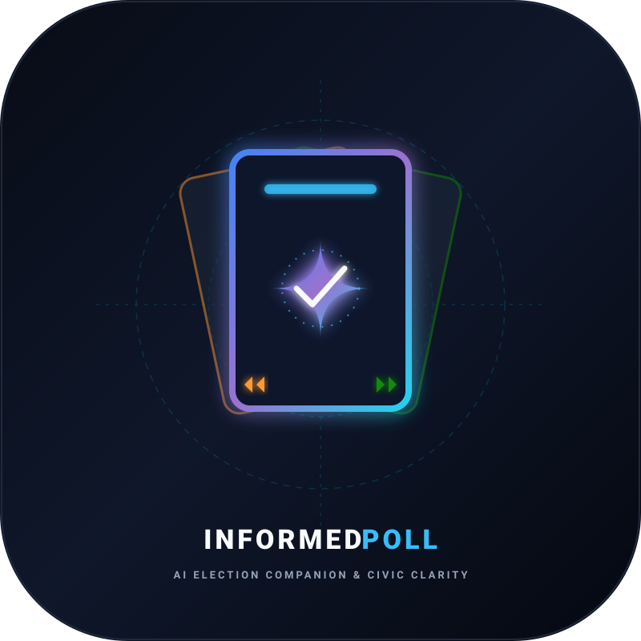
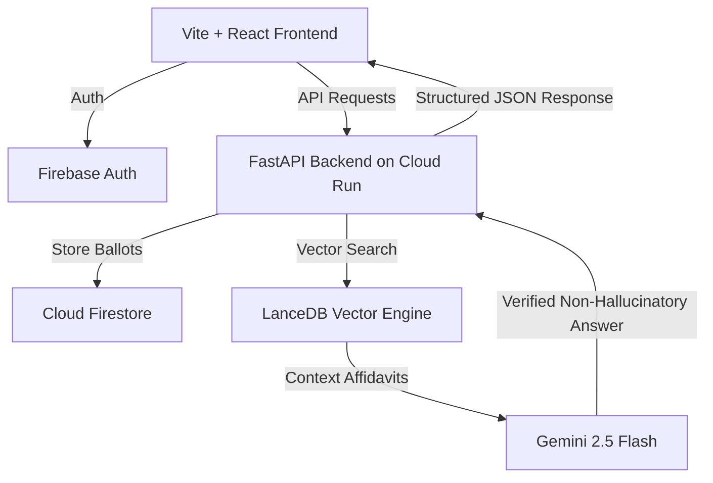

<p align="center">
  
</p>

<h1 align="center">Informed Poll</h1>

<p align="center">
  <strong>AI-Driven Mobile-First Election Companion &amp; Civic Clarity Engine with Gemini 2.5 Flash.</strong>
</p>

<p align="center">
  <a href="LICENSE"></a>
  
  
  
  
  
  <a href="future.md"></a>
</p>

> **"Empowering the next generation of voters with AI-driven civic clarity."**

---

## ⚡ Overview

**Informed Poll** is a high-fidelity, mobile-first election companion designed for first-time voters. It combines the intuitive "swipe" mechanics of modern social apps with a sophisticated **RAG (Retrieval-Augmented Generation)** engine to demystify complex political landscapes.

---

## 🚀 Deployment Status
- **Production URL**: [informed-poll.run.app](https://informed-poll-frontend-51884867643.us-central1.run.app)
- **API Documentation**: [informed-poll-api.run.app/docs](https://informed-poll-backend-51884867643.us-central1.run.app/docs)
- **Region**: `us-central1`
- **Engine**: Google Cloud Run (Fully Managed)

---

## 🏗️ System Architecture



---

## ✨ Key Features

### 🃏 Swipeable Candidate Cards
Tactical, gesture-driven interface for exploring candidates. Build your "Personal Ballot" with intuitive left/right swipes.

### 🧠 VoteIQ: Neural Sync RAG
A conversational civic assistant grounded in verified **Election Commission of India (ECI)** affidavit data using **LanceDB** and **Gemini 2.5 Flash**.

### 🗺️ Civic Dossier
A comprehensive, interactive timeline of the voting journey—from Form 6 voter registration to polling booth protocols.

### 🔐 Secure & Non-Partisan
Stateless backend with Firebase Auth (OIDC) and Google Cloud Firestore for encrypted, private ballot storage.

---

## 🛠️ Quick Start

### Prerequisites
- Python 3.11+
- Node.js 18+
- Google Cloud Project with Vertex AI enabled

### Local Setup
```bash
git clone https://github.com/seeramsujay/informed-poll.git
cd informed-poll
pip install -r requirements.txt
cd frontend && npm install
```

### Run Locally
```bash
# Backend (port 8000)
python main.py

# Frontend (port 5173)
cd frontend && npm run dev
```

---

## 🔮 Engineering Roadmap

To explore planned features including Bhashini multilingual speech recognition across 22 Indian languages, zero-knowledge ballot cryptography, and live fact-checking crawlers, read [future.md](future.md).

---

## 📄 License

Distributed under the MIT License. See `LICENSE` for details.
